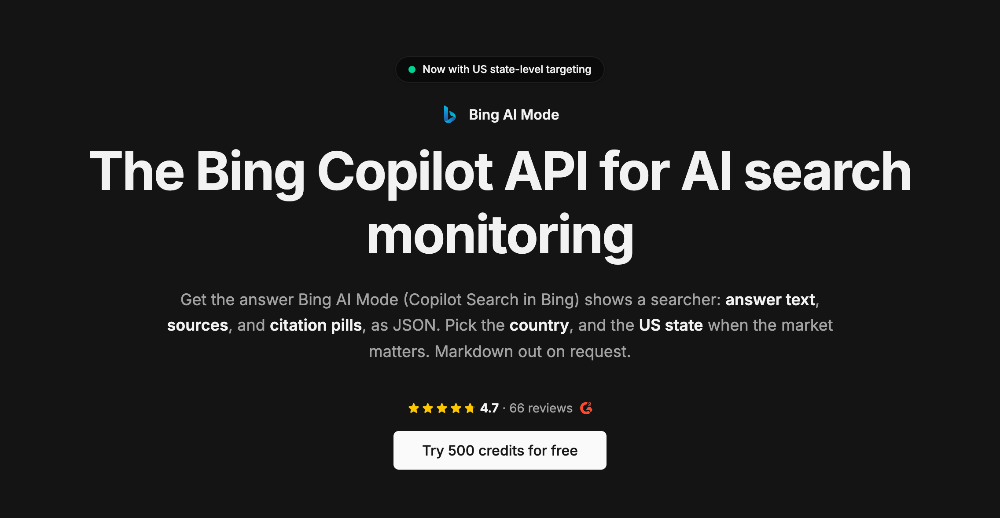

# Microsoft Copilot Scraper

[](https://cloro.dev/bing-ai-mode/?utm_source=github)

[](https://cloro.dev/)

The [Bing Copilot scraper](https://cloro.dev/bing-ai-mode/?utm_source=github) by cloro is an API for Copilot Search in Bing, the AI answer page at `bing.com/copilotsearch`. It returns the answer as structured JSON: answer text and markdown, every source Bing read, and the inline citation pills with their domains. cloro calls this endpoint Bing AI Mode.

> **This repository now covers Copilot Search in Bing.** It used to document cloro's scraper for the Copilot app at `copilot.microsoft.com`. That endpoint is discontinued, because the Copilot app blocks logged-out sessions: `/v1/monitor/copilot` returns a `400` (`MODEL_UNAVAILABLE`) and costs no credits. Copilot Search in Bing answers from the same Bing index without a login, and cloro returns it through `/v1/monitor/bing/aimode`.

## How do you scrape Microsoft Copilot?

1. Get an API key at [cloro.dev](https://cloro.dev/?utm_source=github&utm_medium=readme).
2. POST a prompt to `https://api.cloro.dev/v1/monitor/bing/aimode`.
3. Read the parsed fields from the JSON response.

Copilot Search is grounded in Bing rather than Google, so its sources often differ from every other engine on the same question. In a 96-prompt comparison, only 86 of 891 cited domains appeared in both Bing AI Mode and Google AI Mode answers ([study](https://cloro.dev/blog/bing-ai-mode-vs-google-ai-mode/)). That difference is the reason to track Bing separately.

### Request sample (Python)

```python
import requests

payload = {
    'prompt': 'best CRM for B2B sales teams',
    'country': 'US',
    'include': {'markdown': True},
}

response = requests.post(
    'https://api.cloro.dev/v1/monitor/bing/aimode',
    headers={'Authorization': 'Bearer YOUR_API_KEY'},
    json=payload,
)

print(response.json())
```

### Request sample (cURL)

```bash
curl -X POST https://api.cloro.dev/v1/monitor/bing/aimode \
  -H "Authorization: Bearer YOUR_API_KEY" \
  -H "Content-Type: application/json" \
  -d '{"prompt": "best CRM for B2B sales teams", "country": "US"}'
```

Node.js and async/webhook examples are in the [endpoint documentation](https://cloro.dev/docs/api-reference/endpoint/monitor-bing-aimode).

### Request parameters

| Parameter | Description | Default |
| --- | --- | --- |
| `prompt`\* | The question. Up to 3,500 characters after URL encoding, fewer for non-Latin scripts | – |
| `country`\* | Country code (`US`, `GB`, `DE`). All countries except `BY`, `CN`, `IR`, `RU`, `SY` and `VE` | – |
| `state` | US state code (`CA`, `NY`), only with `country: "US"` | – |
| `include.markdown` | Return the answer as Markdown | `false` |
| `include.html` | Return a URL to the page Bing rendered | `false` |

\* Required

## What data does the Bing Copilot scraper return?

```json
{
  "success": true,
  "result": {
    "text": "The Galaxy S26 is the stronger performer with a more versatile camera and larger battery, while the iPhone 17 offers a sharper display...",
    "sources": [
      {
        "position": 1,
        "label": "Apple iPhone 17 vs Samsung Galaxy S26 - 91mobiles.com",
        "url": "https://www.91mobiles.com/compare/Apple/iPhone+17/vs/Samsung/Galaxy+S26.html",
        "description": "Comparing the Apple iPhone 17 vs Samsung Galaxy S26 across performance, display, camera..."
      }
    ],
    "citationPills": [
      {
        "position": 1,
        "label": "Apple iPhone 17 vs Samsung Galaxy S26 - 91mobiles.com",
        "url": "https://www.91mobiles.com/compare/Apple/iPhone+17/vs/Samsung/Galaxy+S26.html",
        "domain": "91mobiles.com",
        "citationPillId": 1
      }
    ]
  }
}
```

Alongside `text`:

1. **`sources`**: the pages Bing read for the answer, then any other page a citation chip links, each with position, label, URL and description ([schema](https://cloro.dev/docs/api-reference/endpoint/bing-aimode/sources)).
2. **`citationPills`**: one entry per chip and source pair, with the cited domain ([schema](https://cloro.dev/docs/api-reference/endpoint/bing-aimode/citation-pills)).
3. **`markdown`**: the answer with each chip replaced by links. Section headings, tables and Bing's follow-up question are only in this field.
4. **`html`**: a URL to the full page Bing rendered.

Full field-level schemas are in the [endpoint reference](https://cloro.dev/docs/api-reference/endpoint/monitor-bing-aimode).

## Use cases

- **Copilot rank tracking**: whether Copilot names your brand and cites your pages on the prompts your buyers ask, by country and US state ([guide](https://cloro.dev/blog/copilot-rank-tracking/)).
- **Cross-engine coverage**: Bing next to ChatGPT, Gemini, Google AI Mode and AI Overview on one key.
- **Source research**: which third-party pages Bing reads and cites for your category.
- **Bing-index research**: Copilot Search shows which pages Bing's AI picks, not only which pages rank.

## FAQ

### Is Copilot Search the same as the Copilot app?

No. Copilot Search in Bing is the AI answer page inside Bing search. The Copilot app at `copilot.microsoft.com` is a separate chat product that needs a Microsoft session, and cloro does not scrape it. Microsoft is testing the label "AI Mode" for the Copilot tab in Bing, and other vendors sell the same page as a "Bing Copilot API".

### Is there an official Microsoft Copilot API for these answers?

No. Microsoft retired the Bing Search APIs in August 2025, and the Microsoft 365 Copilot APIs answer from your own tenant's data. No Microsoft API returns the public Copilot Search answer.

### Does cloro return Bing search results?

No. cloro returns Bing's AI answer only, not Bing's organic, ads, news, image or video results.

### What does a request cost?

4 credits on the async API, the same as Google AI Mode. A sync request adds 2 credits, and a US state adds 2 more ([pricing](https://cloro.dev/pricing/)).

### What is the recommended timeout?

At least 5 minutes (300 seconds), because cloro retries failed attempts server-side before it answers ([retries and cancellation](https://cloro.dev/docs/guides/error-handling#retries-and-cancellation)).

## Learn more

- **Endpoint reference:** [cloro.dev/docs](https://cloro.dev/docs/api-reference/endpoint/monitor-bing-aimode)
- **Product page:** [cloro.dev/bing-ai-mode](https://cloro.dev/bing-ai-mode/)
- **Compare vendors:** [Best Bing Copilot API](https://cloro.dev/blog/best-bing-copilot-api/)

## Other cloro scrapers

[AI Mode](https://cloro.dev/ai-mode/) · [AI Overview](https://cloro.dev/ai-overview/) · [ChatGPT](https://cloro.dev/chatgpt/) · [Gemini](https://cloro.dev/gemini/) · [Google Search](https://cloro.dev/google-search/) · [Google News](https://cloro.dev/google-news/)

## Contact us

Questions or support: [ask the docs AI assistant](https://cloro.dev/docs/?assistant).
